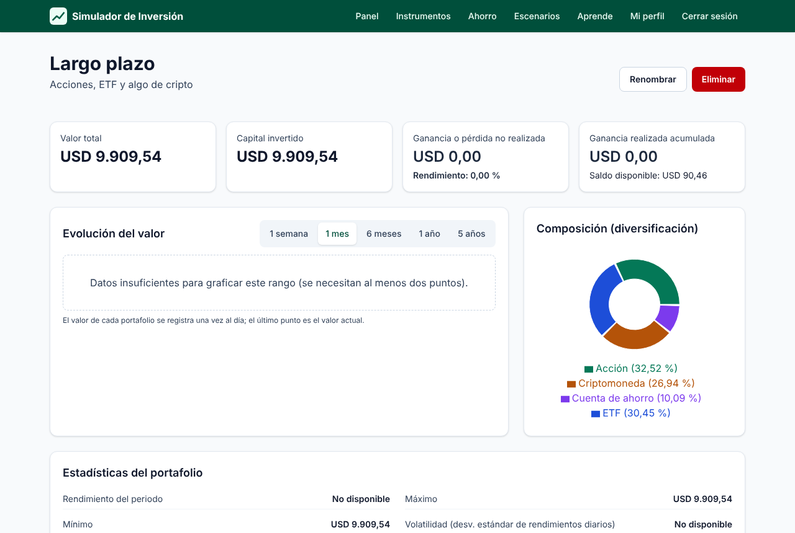

# Plataforma de Simulación de Inversión

[](https://github.com/Judator07/proyecto-clase-software1/actions/workflows/ci.yml)


Aplicación web **educativa** para simular inversiones en **acciones, ETF, criptomonedas y cuentas de ahorro** con dinero ficticio y precios reales del mercado.

**Demo en producción:** <https://simulador-inversion.juandanieltorresr.workers.dev>

> Proyecto final de **Ingeniería de Software I**, Escuela de Ingeniería de Sistemas e Informática, Universidad Industrial de Santander (2026-2). Docente: Gabriel Pedraza Ferreira.

> ⚠️ Plataforma de simulación con fines educativos. No usa dinero real ni constituye asesoría financiera.



## Funcionalidades

| Módulo                    | Qué permite                                                                                                                                         | Requerimientos |
| ------------------------- | --------------------------------------------------------------------------------------------------------------------------------------------------- | -------------- |
| Registro y perfil         | Cuenta con USD 10.000 ficticios, perfil y reinicio por bancarrota simulada (patrimonio menor que USD 100)                                           | RF-01 a RF-05  |
| Simulación de inversiones | Catálogo con búsqueda; precios actuales e históricos de hasta 5 años; compra y venta en 3 pasos; cuentas de ahorro con interés compuesto; historial | RF-06 a RF-11  |
| Portafolios               | Hasta 10 portafolios con balance, rendimiento, ganancia realizada y liquidación al eliminar                                                         | RF-12 a RF-14  |
| Datos y gráficos          | Evolución de precio y de valor, composición, estadísticas (volatilidad, media móvil de 20 días) y precios actualizados cada 15 min                  | RF-15 a RF-18  |
| Aprendizaje               | Centro de contenido educativo público, administrable                                                                                                | RF-19, RF-20   |
| Escenarios                | Crisis, mercado alcista, alza de tasas o personalizado, con rango por volatilidad                                                                   | RF-21, RF-22   |

## Arquitectura

```
Navegador (SPA React) ──HTTPS/JSON──► Cloudflare Worker (API Hono) ──► Cloudflare D1 (SQLite)
                                            │   ▲
                                            │   └── Cron cada 15 min (RF-17)
                                            └──► Yahoo Finance (precios e históricos)
```

- **Capas (RNF-11):**
  - `src/dominio`: reglas y cálculos puros, compartidos por cliente y servidor.
  - `src/server/rutas`: API REST con validación Zod.
  - `src/server/servicios`: lógica de negocio.
  - `src/server/datos`: SQL sobre D1 y el proveedor de mercado.
  - `src/client`: interfaz.
- **Integridad (RNF-10):** cada operación es un `DB.batch()` atómico, y las restricciones `CHECK` impiden saldos o posiciones negativos, incluso con solicitudes concurrentes.
- **Stack:** TypeScript, React, React Router, Tailwind CSS, Recharts, Hono, Zod, Cloudflare Workers, D1, Vite, Vitest, Playwright y axe-core.

El detalle está en la sección de [diseño del informe](docs/informe/04-diseno.md).

## Calidad

| Tipo de prueba                                                      | Cantidad | Herramienta                 |
| ------------------------------------------------------------------- | -------- | --------------------------- |
| Unitarias (dominio, con los criterios de aceptación del SRS)        | 36       | Vitest                      |
| Integración (API + D1 en el runtime de Workers)                     | 42       | `@cloudflare/vitest-plugin` |
| Extremo a extremo y accesibilidad WCAG 2.1 AA (escritorio y 360 px) | 10       | Playwright + axe            |
| Carga (50 usuarios concurrentes, 10 min, en producción)             | 1        | `tests/carga/carga.mjs`     |

Los resultados completos y la matriz de trazabilidad están en [Validación](docs/informe/05-validacion.md).

## Inicio rápido

Requisitos: Node.js 22 o superior.

```bash
npm install
```

```bash
npm run db:migrar:local
```

```bash
npm run dev
```

La aplicación queda en `http://localhost:5173`, con una base D1 local en `.wrangler/`.

## Scripts

| Script                                | Descripción                                                                |
| ------------------------------------- | -------------------------------------------------------------------------- |
| `npm run dev`                         | Servidor de desarrollo (SPA y Worker)                                      |
| `npm run build`                       | Compilación de producción                                                  |
| `npm run lint` / `npm run typecheck`  | Calidad de código                                                          |
| `npm test` / `npm run test:cobertura` | Pruebas unitarias y de integración, con cobertura                          |
| `npm run test:e2e`                    | Pruebas E2E en local; contra producción: `URL_BASE=<url> npm run test:e2e` |
| `npm run test:carga -- <url> 50 600`  | Prueba de carga (usuarios, segundos)                                       |
| `npm run db:migrar:local`             | Aplica las migraciones a la D1 local                                       |
| `npm run informe:pdf`                 | Genera los PDF del informe y del manual (requiere pandoc)                  |
| `npm run deploy`                      | Aplica las migraciones remotas y despliega (lo usa Workers Builds)         |

## Despliegue

Cada integración a `main` se despliega automáticamente con **Cloudflare Workers Builds**:

- **Build:** `npm run build`
- **Deploy:** `npm run deploy`

El Worker se llama `simulador-inversion` y la base de datos D1 es `simulador-inversion-db`. Para crear una cuenta de administrador, ejecuta lo siguiente y luego corre el SQL generado en la consola de D1:

```bash
node scripts/crear-admin.mjs <correo> "<nombre>"
```

## Documentación

- 📄 [Informe final en PDF](docs/entregas/Informe_Final_Plataforma_Simulacion_Inversion.pdf), también por secciones en Markdown:
  1. [Problema](docs/informe/01-problema.md)
  2. [Requerimientos](docs/informe/02-requerimientos.md)
  3. [Análisis UML](docs/informe/03-analisis.md)
  4. [Diseño](docs/informe/04-diseno.md)
  5. [Validación](docs/informe/05-validacion.md)
  6. [Proceso](docs/informe/06-proceso.md)
  7. [Conclusiones](docs/informe/07-conclusiones.md)
  8. [Perspectivas](docs/informe/08-perspectivas.md)
- 📘 [Manual de usuario](docs/manual-usuario.md), también en [PDF](docs/entregas/Manual_de_Usuario_Plataforma_Simulacion_Inversion.pdf).
- Entregas previas del equipo: [SRS v1.0](docs/entregas/SRS_Plataforma_Simulacion_Inversion_v1.0.pdf) y [Taller de análisis UML](docs/entregas/Taller_UML_Plataforma_Simulacion_Inversion_v1.0.pdf).
- [Progreso del proyecto](docs/PROGRESO.md) y [guía de contribución](CONTRIBUTING.md).

## Equipo

- Juan Daniel Torres Ramírez
- Camilo Andrés Velandia Mendoza
- Santiago Fonseca Hernández

## Uso de inteligencia artificial

Siguiendo la orientación de la asignatura, la construcción se hizo con apoyo de un asistente de IA (Claude Code). El equipo es autor de los requerimientos (SRS) y del análisis (Taller UML), tomó las decisiones de producto e infraestructura, y revisa y valida el resultado. El detalle está en el informe, [sección 6.4](docs/informe/06-proceso.md#64-uso-de-inteligencia-artificial).

## Licencia

[MIT](LICENSE)
