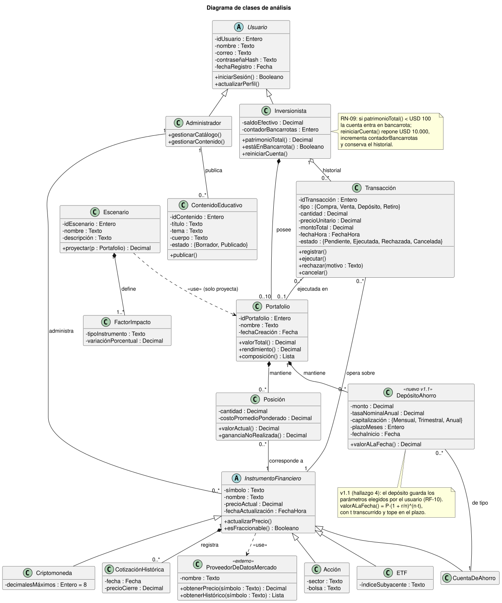
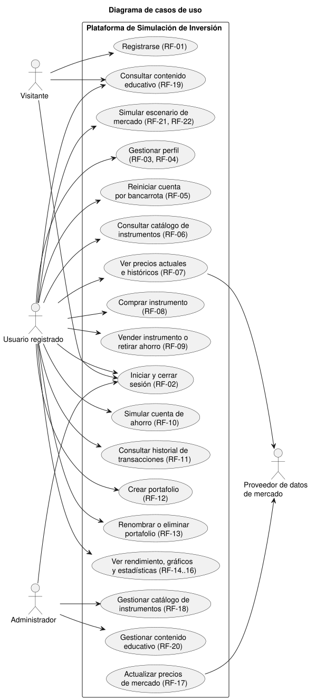
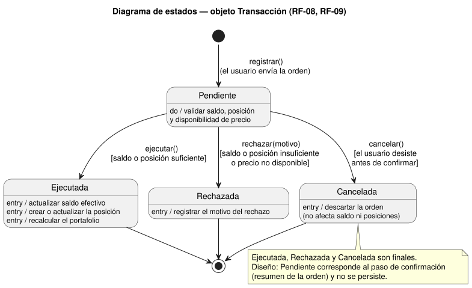
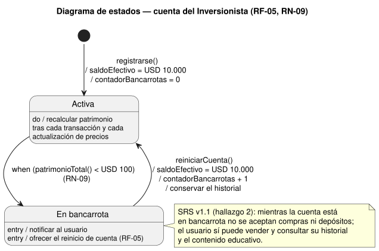
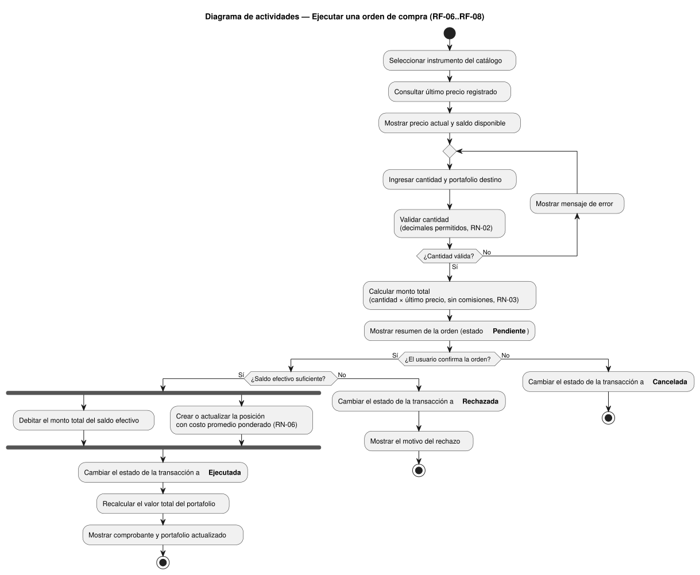

# 3. Análisis del sistema (UML)

El análisis orientado a objetos se elaboró en el [Taller de análisis UML](../entregas/Taller_UML_Plataforma_Simulacion_Inversion_v1.0.pdf). Los diagramas de esta sección son la versión corregida según el [SRS v1.1](02-requerimientos.md#23-cambios-de-la-versión-11-del-srs). Las fuentes PlantUML están en [`docs/uml/analisis/`](../uml/analisis/) y se generaron con PlantUML 1.2025.4.

| Diagrama                  | Tipo de modelo                 | Pregunta que responde                               |
| ------------------------- | ------------------------------ | --------------------------------------------------- |
| Clases                    | Estático (datos)               | Qué conceptos existen y cómo se relacionan          |
| Casos de uso              | Comportamiento (vista externa) | Quién usa el sistema y qué puede hacer              |
| Estados de la Transacción | Estado                         | Cómo evoluciona una orden hasta quedar cerrada      |
| Estados de la cuenta      | Estado                         | Cómo funcionan la bancarrota simulada y el reinicio |
| Actividades de la compra  | Comportamiento (proceso)       | Cómo fluye la operación central del sistema         |

## 3.1 Diagrama de clases

**Decisiones de modelado:**

- **Inversionista ◆ Portafolio** es una composición con multiplicidad 0..10, porque RN-05 limita a diez portafolios por usuario y un portafolio no existe sin su dueño.
- **Portafolio ◆ Posición** y **Portafolio ◆ DepósitoAhorro** son composiciones: al eliminar el portafolio se liquida su contenido (RN-07).
- **Inversionista ◇ Transacción** es una agregación, porque el historial sobrevive al reinicio por bancarrota y a la eliminación de un portafolio. Por eso Transacción se asocia con Portafolio con multiplicidad 0..1.
- **InstrumentoFinanciero** es abstracta y concentra símbolo, precio y fecha de actualización. Sus cuatro subclases solo añaden lo que las diferencia. Solo Criptomoneda es fraccionable (RN-02).
- **Cambios v1.1:**
  - `Transacción.tipo` incluye Depósito y Retiro.
  - Se agrega **DepósitoAhorro**, que guarda los parámetros que elige el usuario en RF-10 (monto, tasa, capitalización, plazo y fecha de inicio).
- **Visitante** no es una clase: es un rol sin estado persistente y solo aparece como actor.

## 3.2 Diagrama de casos de uso

| Actor                         | Tipo                 | Responsabilidad                                                                                             |
| ----------------------------- | -------------------- | ----------------------------------------------------------------------------------------------------------- |
| Visitante                     | Primario             | Consulta el contenido educativo sin registrarse, se registra e inicia sesión.                               |
| Usuario registrado            | Primario             | Opera la simulación: portafolios, compras y ventas, ahorro, gráficos, escenarios y reinicio por bancarrota. |
| Administrador                 | Primario             | Mantiene el catálogo de instrumentos (RF-18) y el contenido educativo (RF-20).                              |
| Proveedor de datos de mercado | Secundario (externo) | Entrega los precios actuales y los históricos (RF-07, RF-17).                                               |

**Cambios v1.1:**

- Se agregan los casos _Simular cuenta de ahorro (RF-10)_ y _Actualizar precios de mercado (RF-17)_.
- Los casos de uso del administrador citan sus RF.
- Cada caso de uso indica el requerimiento exacto del que proviene, en lugar del grupo de requerimientos.

## 3.3 Diagrama de estados de la Transacción

| Estado origen | Evento           | Guarda                                                | Estado destino |
| ------------- | ---------------- | ----------------------------------------------------- | -------------- |
| (inicio)      | registrar()      | El usuario envía la orden                             | Pendiente      |
| Pendiente     | ejecutar()       | Saldo o posición suficiente y precio disponible       | Ejecutada      |
| Pendiente     | rechazar(motivo) | Saldo o posición insuficiente, o precio no disponible | Rechazada      |
| Pendiente     | cancelar()       | El usuario desiste antes de confirmar                 | Cancelada      |

Los tres desenlaces son finales: una vez cerrada, la transacción queda en el historial y no vuelve a cambiar. Las acciones de entrada reflejan las reglas de negocio:

- **Ejecutada** mueve el saldo y la posición.
- **Rechazada** registra el motivo.
- **Cancelada** no toca nada.

## 3.4 Diagrama de estados de la cuenta del Inversionista

- La transición a **En bancarrota** es un evento de cambio: ocurre cuando el patrimonio total cae por debajo de USD 100 (RN-09), sin que el usuario haga nada.
- El reinicio:
  - repone USD 10.000;
  - incrementa el contador;
  - **conserva el historial**, lo que justifica modelarlo como agregación.
- El supuesto del Taller sobre las órdenes en bancarrota quedó confirmado en el SRS v1.1.

## 3.5 Diagrama de actividades de la orden de compra

El flujo concentra las reglas de negocio más importantes:

- validación de decimales (RN-02);
- cálculo al último precio sin comisiones (RN-03);
- costo promedio ponderado (RN-06);
- los tres desenlaces posibles de una orden.

El par _fork/join_ indica que el débito del saldo y la actualización de la posición deben completarse ambos antes de dar la orden por ejecutada. En el diseño esto se garantiza con una **transacción de base de datos atómica** (RNF-10).

La venta sigue el mismo flujo: cambia "saldo suficiente" por "posición suficiente" (RN-04) y el débito por un abono.

## 3.6 Trazabilidad con el SRS

| Requerimientos      | Contenido                                            | Diagramas                                                    |
| ------------------- | ---------------------------------------------------- | ------------------------------------------------------------ |
| RF-01 a RF-05       | Registro, perfil y reinicio por bancarrota           | Clases, casos de uso, estados de la cuenta                   |
| RF-06 a RF-11       | Catálogo, precios, compra, venta, ahorro e historial | Clases, casos de uso, estados de la transacción, actividades |
| RF-12 a RF-14       | Portafolios                                          | Clases, casos de uso                                         |
| RF-15 a RF-18       | Gráficos, estadísticas, precios y catálogo           | Clases (CotizaciónHistórica, Proveedor), casos de uso        |
| RF-19 a RF-20       | Contenido educativo                                  | Clases, casos de uso                                         |
| RF-21 a RF-22       | Escenarios                                           | Clases (Escenario, FactorImpacto), casos de uso              |
| RN-02, RN-03, RN-06 | Cantidades, precio de ejecución y costo promedio     | Actividades                                                  |
| RN-09               | Bancarrota simulada                                  | Clases, estados de la cuenta                                 |
