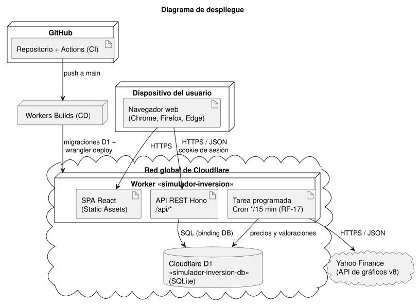
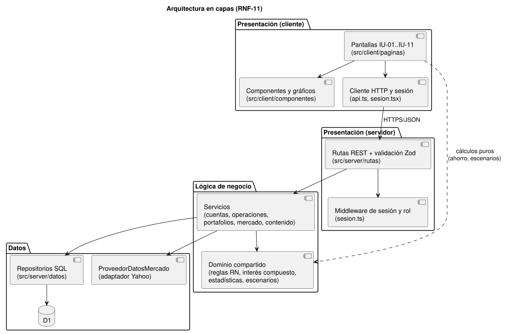
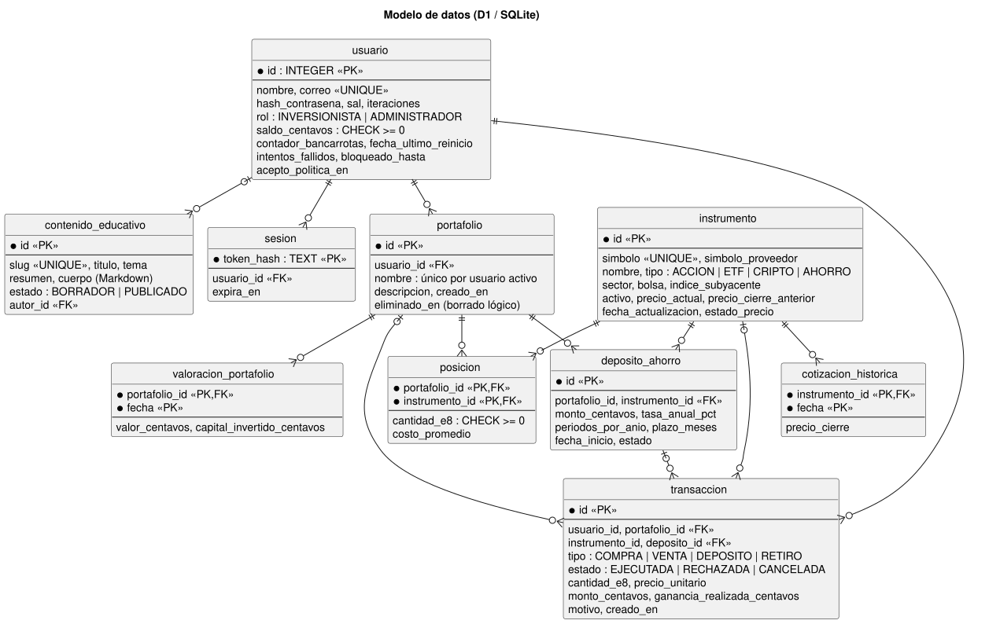
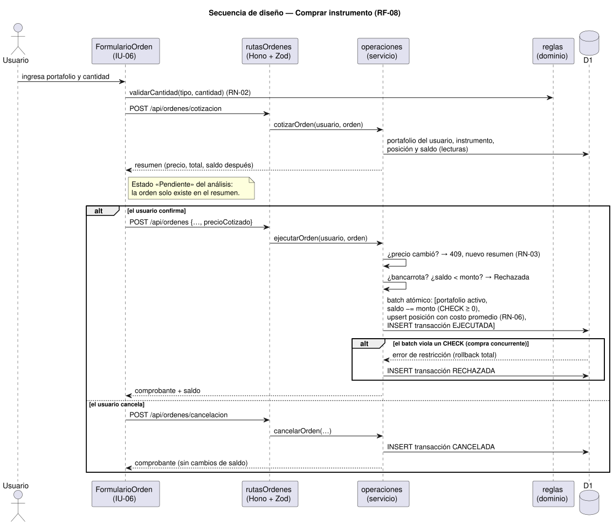

# 4. Diseño del sistema

El diseño refina el modelo de análisis (sección 3) para una plataforma concreta: **Cloudflare Workers** (cómputo en el borde de la red) y **Cloudflare D1** (base de datos relacional SQLite). Las fuentes de los diagramas están en [`docs/uml/diseno/`](../uml/diseno/).

## 4.1 Arquitectura general y despliegue

La arquitectura es **cliente-servidor**, como pide el SRS §2.1:

- **Cliente.** Aplicación de una sola página (SPA) en React que corre en el navegador. Se distribuye como recursos estáticos desde la red de Cloudflare.
- **Servidor.** Un único Worker atiende la API REST bajo `/api/*`, con JSON sobre HTTPS. También ejecuta la tarea programada de actualización de precios (RF-17) cada 15 minutos.
- **Datos.** Cloudflare D1, una base relacional administrada, se accede con un _binding_, sin credenciales en el código.
- **Proveedor externo.** Yahoo Finance entrega los precios actuales y el histórico (TBD-1).
- **Integración y entrega continuas:**
  - GitHub Actions ejecuta lint, tipos, pruebas y build en cada push y en cada PR.
  - Cloudflare Workers Builds despliega automáticamente cada integración a `main`: primero aplica las migraciones de D1 y luego publica el Worker.

URL de producción: <https://simulador-inversion.juandanieltorresr.workers.dev>.

## 4.2 Arquitectura en capas (RNF-11)

| Capa                    | Ubicación                                                              | Responsabilidad                                                                                                     |
| ----------------------- | ---------------------------------------------------------------------- | ------------------------------------------------------------------------------------------------------------------- |
| Presentación (cliente)  | `src/client`                                                           | Pantallas IU-01 a IU-11, componentes, gráficos (Recharts) y cliente HTTP.                                           |
| Presentación (servidor) | `src/server/rutas`, `src/server/sesion.ts`, `src/server/validacion.ts` | Contrato REST, validación de entradas (Zod), autenticación y autorización.                                          |
| Lógica de negocio       | `src/server/servicios`, `src/dominio`                                  | Orquestación de operaciones y reglas de negocio. El dominio son funciones puras compartidas por cliente y servidor. |
| Datos                   | `src/server/datos`, `migrations/`                                      | Repositorios SQL sobre D1 y el adaptador del proveedor de mercado.                                                  |

**Dominio compartido.** El cliente importa la capa de dominio para dos cosas:

- validar al instante (cantidad, contraseña);
- calcular las proyecciones puras: ahorro (RF-10) y escenarios (RF-21, RF-22).

El servidor vuelve a validar todo lo que modifica datos. Así una sola implementación, probada al 100 %, sirve a ambos lados. Además se garantiza RN-08: el simulador de escenarios no tiene ningún camino para escribir en la base de datos.

## 4.3 Modelo de datos

### Correspondencia con el modelo de análisis

| Clase de análisis                     | Tabla                   | Notas                                                                                       |
| ------------------------------------- | ----------------------- | ------------------------------------------------------------------------------------------- |
| Usuario, Inversionista, Administrador | `usuario`               | Herencia en una sola tabla con `rol`.                                                       |
| Portafolio                            | `portafolio`            | Borrado lógico, para que el historial sobreviva a la eliminación (agregación del análisis). |
| Posición                              | `posicion`              | PK compuesta (portafolio, instrumento).                                                     |
| DepósitoAhorro                        | `deposito_ahorro`       | Clase agregada en el SRS v1.1.                                                              |
| Transacción                           | `transaccion`           | El estado Pendiente no se persiste (ver §4.7, D4).                                          |
| InstrumentoFinanciero y subclases     | `instrumento`           | Herencia en una sola tabla con `tipo` y columnas opcionales (sector, bolsa, índice).        |
| CotizaciónHistórica                   | `cotizacion_historica`  | Un cierre diario por instrumento.                                                           |
| —                                     | `valoracion_portafolio` | Valor diario de cada portafolio (RF-17), para el gráfico de RF-15.                          |
| ContenidoEducativo                    | `contenido_educativo`   | Cuerpo en Markdown.                                                                         |
| Escenario y FactorImpacto             | —                       | Son constantes del dominio (`ESCENARIOS_PREDEFINIDOS`); no necesitan persistencia.          |

### Invariantes en la base de datos (RNF-10)

- `CHECK (saldo_centavos >= 0)`: el saldo nunca puede ser negativo.
- `CHECK (cantidad_e8 >= 0)`: no se puede vender más de lo que se posee (RN-04).
- Índice único parcial `(usuario_id, nombre)` sobre los portafolios activos (RN-05).
- Disparador `trg_limite_portafolios`: máximo 10 portafolios activos (RN-05), incluso ante solicitudes simultáneas.

## 4.4 Comportamiento: secuencia de la compra

La orden de compra sigue el diagrama de actividades del análisis:

1. **Resumen de confirmación.** La cotización no tiene estado y equivale al estado _Pendiente_.
2. **Ejecución.** Ocurre dentro de un **único `DB.batch()`**, que D1 ejecuta como una transacción.
3. **Ante una compra simultánea**, si el saldo ya no alcanza, el `CHECK` aborta todo el batch. La orden se registra como **Rechazada**, sin cambios parciales.

La venta, el depósito y el retiro siguen el mismo patrón.

## 4.5 API REST

Todas las rutas usan el prefijo `/api`. Las marcadas con 🔒 requieren sesión; las marcadas con 🛡️ requieren el rol Administrador.

| Método y ruta                                                               | Descripción                                                     | RF                  |
| --------------------------------------------------------------------------- | --------------------------------------------------------------- | ------------------- |
| `POST /auth/registro`                                                       | Registro con consentimiento; inicia la sesión                   | RF-01               |
| `POST /auth/ingreso`, `POST /auth/salida`                                   | Inicio y cierre de sesión                                       | RF-02               |
| `GET /auth/sesion`                                                          | Usuario de la sesión actual, o `null`                           | RF-02               |
| 🔒 `GET/PATCH /perfil`, `POST /perfil/reinicio`                             | Perfil, actualización y reinicio por bancarrota                 | RF-03, RF-04, RF-05 |
| 🔒 `GET /instrumentos?q=&tipo=`, `GET /instrumentos/:simbolo`               | Catálogo y detalle                                              | RF-06               |
| 🔒 `GET /instrumentos/:simbolo/historico?rango=`                            | Serie de cierres y estadísticas                                 | RF-07, RF-16        |
| 🔒 `GET/POST /portafolios`, `GET/PATCH/DELETE /portafolios/:id`             | Gestión de portafolios y liquidación                            | RF-12, RF-13, RF-14 |
| 🔒 `GET /portafolios/:id/valoracion?rango=`                                 | Evolución del valor, estadísticas y composición                 | RF-15, RF-16        |
| 🔒 `POST /ordenes/cotizacion`, `POST /ordenes`, `POST /ordenes/cancelacion` | Resumen, ejecución y cancelación de órdenes                     | RF-08, RF-09        |
| 🔒 `POST /ahorro/depositos`, `POST /ahorro/depositos/:id/retiro`            | Depósito y retiro de ahorro                                     | RF-10, RF-09        |
| 🔒 `GET /transacciones?portafolioId=&desde=&hasta=&tipo=&simbolo=`          | Historial con filtros                                           | RF-11               |
| `GET /contenido?tema=&q=`, `GET /contenido/:slug`                           | Contenido publicado, sin sesión                                 | RF-19               |
| 🛡️ `GET/POST/PATCH /admin/instrumentos`                                     | Catálogo                                                        | RF-18               |
| 🛡️ `GET/POST/PUT/DELETE /admin/contenido`                                   | Contenido educativo                                             | RF-20               |
| `GET /salud`                                                                | Estado del servicio y de la base de datos (monitoreo de RNF-09) | —                   |

Los errores siguen el formato `{ "error": "mensaje en español", "detalles": { "campo": "…" } }` con su código HTTP:

| Código | Significado                   |
| ------ | ----------------------------- |
| 400    | Validación                    |
| 401    | Sin sesión                    |
| 403    | Sin rol                       |
| 404    | No existe o no es del usuario |
| 409    | Conflicto de negocio          |
| 422    | Símbolo desconocido           |
| 423    | Cuenta bloqueada              |

## 4.6 Tabla de pantallas

| IU    | Pantalla                         | Ruta                         | RF                                       |
| ----- | -------------------------------- | ---------------------------- | ---------------------------------------- |
| —     | Inicio (pública)                 | `/`                          | —                                        |
| IU-01 | Registro e inicio de sesión      | `/registro`, `/ingresar`     | RF-01, RF-02                             |
| IU-02 | Perfil de usuario                | `/perfil`                    | RF-03, RF-04, RF-05                      |
| IU-03 | Panel principal                  | `/panel`                     | RF-03, RF-12                             |
| IU-04 | Catálogo de instrumentos         | `/instrumentos`              | RF-06                                    |
| IU-05 | Detalle de instrumento           | `/instrumentos/:simbolo`     | RF-07, RF-15, RF-16                      |
| IU-06 | Operación de compra o venta      | Formulario en IU-05 e IU-08  | RF-08, RF-09                             |
| IU-07 | Simulador de cuenta de ahorro    | `/ahorro`                    | RF-10                                    |
| IU-08 | Detalle de portafolio            | `/portafolios/:id`           | RF-09, RF-11, RF-13, RF-14, RF-15, RF-16 |
| IU-09 | Centro de aprendizaje            | `/aprende`, `/aprende/:slug` | RF-19                                    |
| IU-10 | Simulador de escenarios          | `/escenarios`                | RF-21, RF-22                             |
| IU-11 | Panel de administración          | `/admin`                     | RF-18, RF-20                             |
| —     | Política de tratamiento de datos | `/privacidad`                | RNF-07                                   |

## 4.7 Decisiones de diseño

| #   | Decisión                                                                       | Alternativas consideradas                                              | Justificación                                                                                                                                                                                                                                                                                                                                                        |
| --- | ------------------------------------------------------------------------------ | ---------------------------------------------------------------------- | -------------------------------------------------------------------------------------------------------------------------------------------------------------------------------------------------------------------------------------------------------------------------------------------------------------------------------------------------------------------- |
| D1  | **Cloudflare Workers + D1 + Workers Builds** (TBD-2)                           | Servidor Node en una máquina virtual con PostgreSQL; Vercel + Supabase | Plan gratuito suficiente, HTTPS y CDN incluidos, base relacional administrada, despliegue automático desde GitHub y un solo lenguaje (TypeScript) en todas las capas. Costo: límites del plan gratuito, como 10 ms de CPU por solicitud.                                                                                                                             |
| D2  | **Dinero en centavos enteros y cantidades en unidades × 10⁸**                  | Números de punto flotante; tipo DECIMAL                                | SQLite no tiene DECIMAL. Con enteros la aritmética es exacta, los CHECK son fiables y se cumplen los criterios de aceptación al centavo: 1.500,00; 3.000,00; 1.126,83.                                                                                                                                                                                               |
| D3  | **Atomicidad con `DB.batch()` y restricciones CHECK**                          | Bloqueos en la aplicación; leer, validar y escribir                    | D1 serializa las escrituras y ejecuta el batch como una transacción. La base de datos es la última barrera: ante compras o ventas simultáneas, solo una procede (RNF-10, verificado con pruebas de concurrencia).                                                                                                                                                    |
| D4  | **El estado Pendiente no se persiste**                                         | Guardar la orden como Pendiente y confirmarla después                  | Evita órdenes huérfanas, dobles confirmaciones y tareas de expiración. El resumen (cotización) cumple el papel de Pendiente; si el precio cambia antes de confirmar, se pide revisar (RN-03).                                                                                                                                                                        |
| D5  | **Proveedor tras una interfaz, con históricos precargados** (TBD-1)            | Twelve Data o Finnhub (requieren clave); CoinGecko solo para cripto    | Yahoo entrega acciones, ETF y cripto con 5 años de historia, sin clave. Al ser una API no oficial, el riesgo se mitiga así: 25.419 cierres en la migración 0004, el último precio guardado y el aviso de precio desactualizado (RNF-04). Cambiar de proveedor solo requiere otro adaptador. Se verificó en producción que Yahoo responde desde la red de Cloudflare. |
| D6  | **Sesiones opacas en cookie HttpOnly y PBKDF2-SHA256 con 100.000 iteraciones** | JWT; bcrypt                                                            | La sesión opaca permite cerrarla de verdad (RF-02) y aplicar la expiración por inactividad (RNF-06). En la base de datos solo se guarda el hash del token. PBKDF2 está disponible de forma nativa en WebCrypto. Se midió en producción el 4 de noviembre de 2026: 6 de 6 derivaciones con 100.000 iteraciones sin exceder el límite de CPU del plan gratuito.        |

## 4.8 Seguridad

- **RNF-05.** Las contraseñas cumplen la política (8 o más caracteres, con letra y número) y se guardan como hash PBKDF2-SHA256 con sal de 128 bits. Solo se usa HTTPS: `workers.dev` no acepta HTTP plano y la SPA envía la cabecera HSTS.
- **RNF-06.**
  - **Sesión.** Tokens aleatorios de 256 bits en una cookie `HttpOnly; Secure; SameSite=Lax` con expiración deslizante de 30 minutos. Al cambiar la contraseña se cierran las demás sesiones.
  - **Bloqueo.** 15 minutos tras 5 intentos fallidos, con incremento atómico del contador.
  - **Autorización.** Rol Administrador para `/admin/*`, y toda consulta filtra por `usuario_id` (no se puede ver ni operar lo ajeno).
- **RNF-07.** Solo se piden nombre y correo. El consentimiento es obligatorio y se guarda su fecha. La política es accesible desde el pie de todas las pantallas.
- **Otras medidas:**
  - consultas SQL siempre parametrizadas;
  - middleware CSRF y cabeceras de seguridad (CSP, X-Frame-Options, nosniff);
  - el contenido Markdown se muestra sin HTML crudo;
  - mensaje genérico ante credenciales incorrectas y tiempo de respuesta igual cuando el correo no existe, para no permitir enumerar cuentas.
