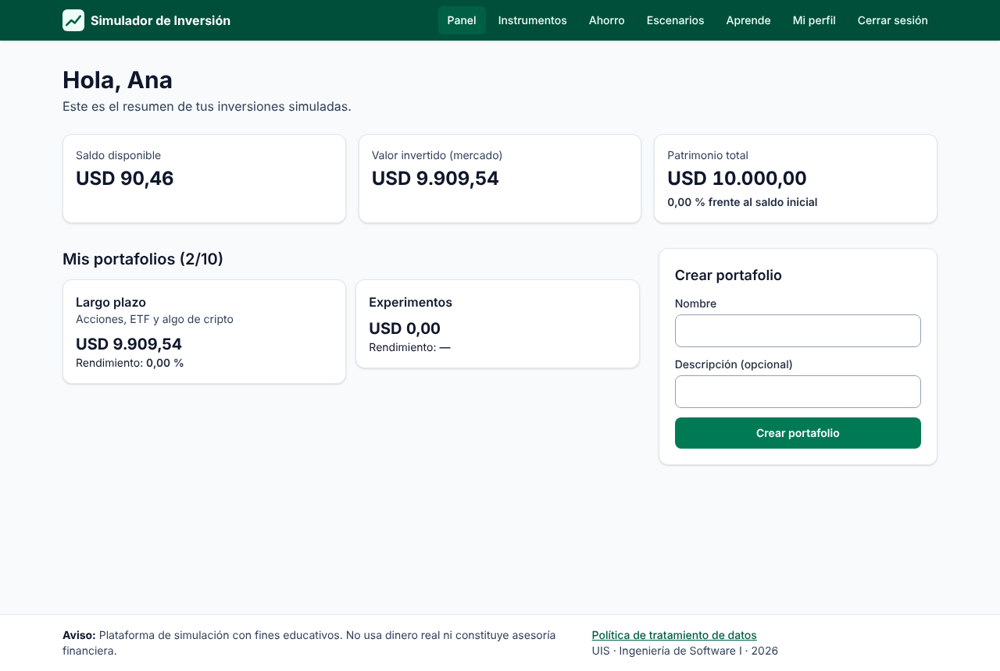
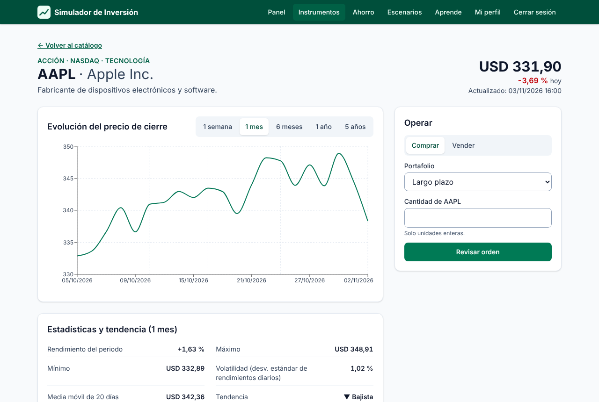
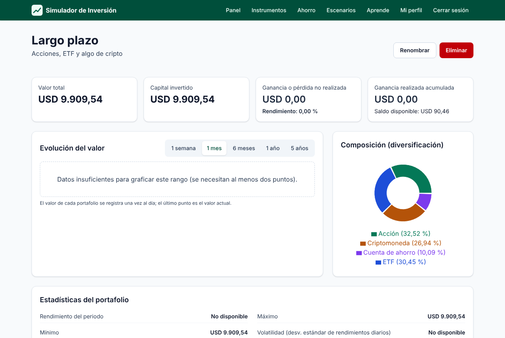
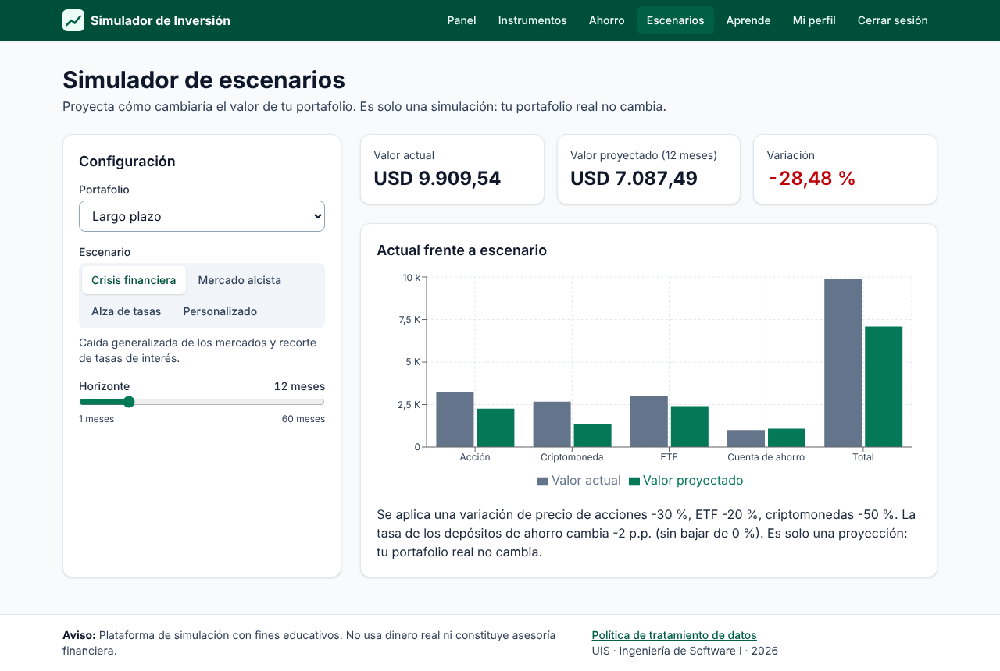

# Manual de usuario

**Plataforma de Simulación de Inversión** · <https://simulador-inversion.juandanieltorresr.workers.dev>

> Plataforma de simulación con fines educativos. No usa dinero real ni constituye asesoría financiera.

## 1. Crear tu cuenta e ingresar

1. En la página de inicio pulsa **Crear cuenta gratis**.
2. Escribe tu nombre, tu correo y una contraseña: mínimo 8 caracteres, con al menos una letra y un número.
3. Marca la autorización de tratamiento de datos (Ley 1581 de 2012) y pulsa **Crear cuenta**.
4. Entras de inmediato a tu **panel** con **USD 10.000,00 ficticios**.

Para volver más tarde usa **Iniciar sesión**. Ten en cuenta:

- Tras 5 intentos fallidos la cuenta se bloquea 15 minutos.
- La sesión se cierra sola después de 30 minutos sin actividad.

## 2. Crear portafolios

En el panel, completa **Crear portafolio** con un nombre (y una descripción, si quieres). Puedes tener hasta **10 portafolios**, cada uno con un nombre distinto. Desde el detalle de un portafolio puedes **renombrarlo** o **eliminarlo**. Al eliminarlo, sus inversiones se venden al precio actual y el dinero vuelve a tu saldo.

## 3. Buscar instrumentos y ver precios

En **Instrumentos** busca por símbolo o nombre (por ejemplo `AAPL` o `Bitcoin`) y filtra por tipo:

- Acciones
- ETF
- Criptomonedas
- Cuenta de ahorro

Al abrir un instrumento verás:

- el precio actual y la fecha de actualización;
- el gráfico de precios (1 semana, 1 mes, 6 meses, 1 año o 5 años);
- las estadísticas: rendimiento, máximo, mínimo, volatilidad y tendencia;
- la tabla histórica.

Si el proveedor de datos falla, verás el aviso **Precio desactualizado** con la fecha del último precio disponible.

## 4. Comprar y vender (3 pasos)

1. En el detalle del instrumento, en **Operar**, elige el portafolio y la cantidad, y pulsa **Revisar orden**:
   - acciones y ETF: unidades enteras;
   - criptomonedas: hasta 8 decimales, por ejemplo `0,05`.
2. Revisa el **resumen**: precio unitario, total sin comisiones y saldo después de la operación. Pulsa **Confirmar compra**, o **Cancelar orden** si cambias de idea.
3. Recibes el **comprobante** con el estado de la orden:
   - **Ejecutada**;
   - **Rechazada**, por ejemplo por saldo insuficiente;
   - **Cancelada**.

Para **vender**, usa el botón **Vender** de la posición en el detalle del portafolio. No puedes vender más de lo que tienes.

## 5. Ver el rendimiento de un portafolio

En el detalle del portafolio encuentras:

- **Indicadores:** valor total, capital invertido, ganancia o pérdida no realizada, rendimiento (%) y ganancia realizada acumulada.
- **Gráficos:** evolución del valor (se registra una vez al día) y composición por tipo de instrumento.
- **Posiciones:** cantidad, costo promedio, precio actual y ganancia de cada una.
- **Historial de transacciones**, con filtros por fechas, tipo e instrumento.

## 6. Simular una cuenta de ahorro

En **Ahorro** ingresa el monto, la tasa nominal anual (0 % a 30 %), el plazo (1 a 120 meses) y la capitalización (mensual, trimestral o anual). Verás el valor final, los intereses y la evolución por periodo.

Si quieres, registra el depósito en un portafolio: se descuenta de tu saldo y crece cada día hasta el plazo. Puedes **retirarlo** cuando quieras desde el portafolio, por su valor acumulado.

## 7. Simular escenarios de mercado

En **Escenarios** elige un portafolio y un escenario:

- **Crisis financiera**;
- **Mercado alcista**;
- **Alza de tasas**;
- **Personalizado**, en el que ajustas las variaciones, la tasa del ahorro y la volatilidad.

Define el horizonte (1 a 60 meses). Verás el valor proyectado, la variación y una explicación. **Tu portafolio real no cambia.**

## 8. Aprender

**Aprende** reúne artículos sobre conceptos básicos, riesgo, rendimiento, diversificación, interés compuesto y criptomonedas. Se pueden leer sin registrarse.

## 9. Perfil y bancarrota simulada

En **Mi perfil** ves tu saldo, tu patrimonio y tu contador de bancarrotas, y puedes cambiar tu nombre o tu contraseña.

Si tu patrimonio (saldo más valor de tus inversiones) cae por debajo de **USD 100,00**, entras en **bancarrota simulada**:

- no puedes comprar ni depositar;
- puedes **reiniciar tu cuenta** con USD 10.000,00: tus posiciones se cierran, tu historial se conserva y se suma una bancarrota a tu contador.

## 10. Administración (solo administradores)

En **Administración** el administrador puede:

- agregar instrumentos (el símbolo se valida con el proveedor de datos);
- activarlos o desactivarlos (un instrumento desactivado no se puede comprar, pero quien lo tenga puede venderlo);
- crear, editar, publicar o eliminar artículos educativos. Los borradores no son visibles para los usuarios.
